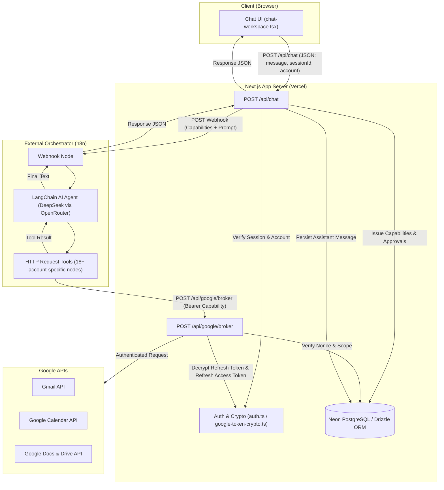
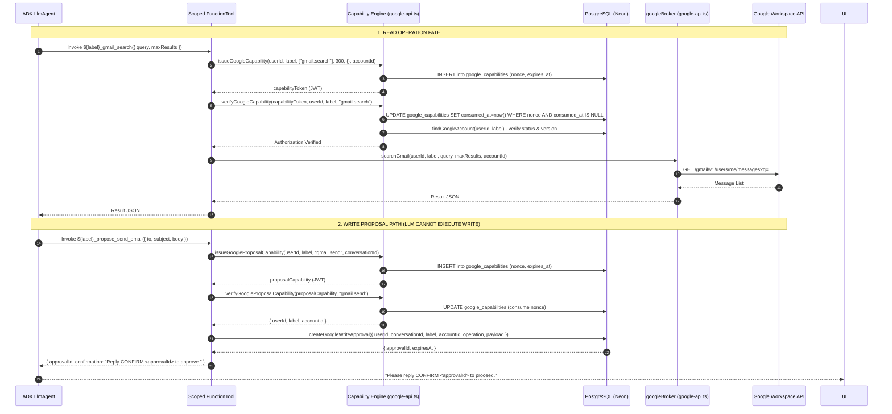
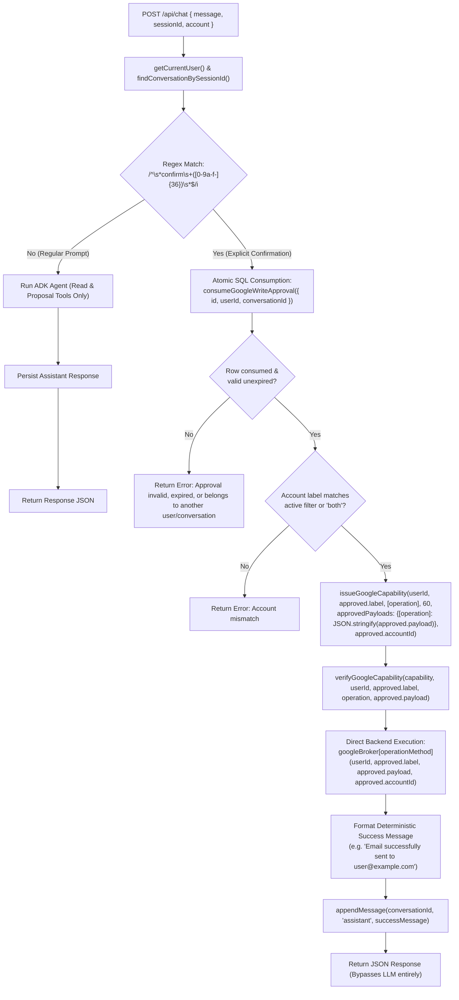
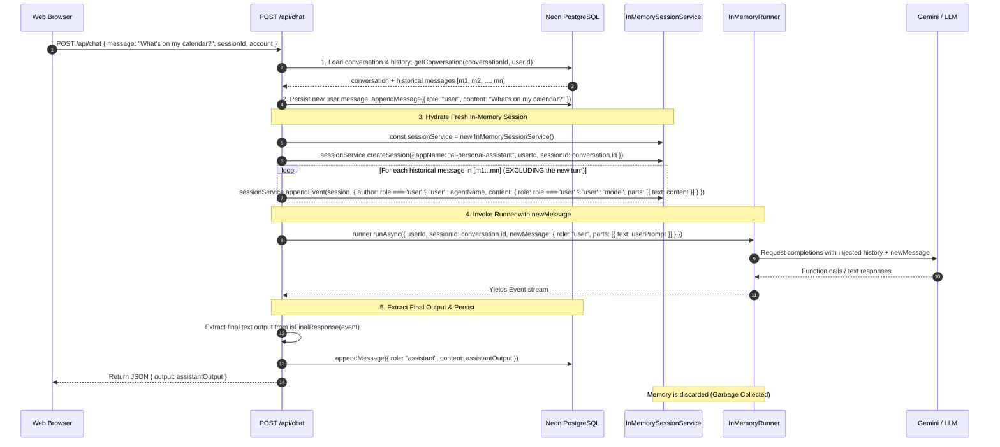
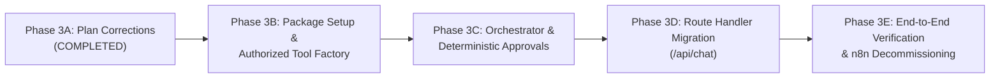

# Phase 3 — Google ADK TypeScript Integration Plan (Revised)

**Target Architecture:** Next.js Node.js Runtime + Google ADK TypeScript (`@google/adk@^2.5.0`) + Neon PostgreSQL (Drizzle ORM)  
**Status:** Audit & Architecture Planning Only — Phase 3A Architecture Corrections (No Source Code or Database Modified)  
**Repository:** `Tejesh-c-dev/ai-personal-assistant` (`C:\AI Personal Assistant`)

---

## 1. Executive Summary & Existing Architecture Audit

### 1.1 Current Architecture Overview

The existing application is a multi-user AI personal productivity assistant built on Next.js 16 (App Router) with React 19 and Tailwind CSS. It connects to Google Workspace APIs (Gmail, Google Calendar, Google Docs) across multiple user-connected Google accounts (e.g. Personal, Official, or custom dynamic labels).

Currently, agent orchestration is delegated externally to an **n8n workflow** over an HTTP webhook (`/api/chat` -> n8n Webhook -> LangChain Agent in n8n -> callback to `/api/google/broker` -> Google APIs).



### 1.2 Component-by-Component Audit Findings

| Component | File Path | Current Role | Migration Fate |
|---|---|---|---|
| **Chat API Route** | `src/app/api/chat/route.ts` | Validates session, creates/updates conversation, issues cryptographic capabilities, posts to n8n webhook, saves response to DB. | **Replace orchestration:** Replace `fetch(webhookUrl)` with direct ADK `Runner` invocation; retain all session, conversation, capability validation, and deterministic approval checks. |
| **Broker Route** | `src/app/api/google/broker/route.ts` | Public HTTP broker endpoint. Receives operation + capability JWT, verifies nonce and signature, executes Google API calls. | **Retain:** Keep available for backwards compatibility or invoke verified capability pipeline directly. |
| **Google Broker Service** | `src/lib/google-api.ts` | Performs token refreshes, calls Gmail/Calendar/Docs endpoints, issues and verifies JWT capabilities with database nonces. | **Retain 100% unmodified:** Complete core capability and broker security logic remains intact. |
| **Write Approval System** | `src/lib/google-write-approvals.ts` | Manages 15-minute pending write proposals in `google_write_approvals` table; enforces single-use atomic consumption. | **Retain 100% unmodified:** Proposal creation and consumption logic remains intact. |
| **OAuth & Token Crypto** | `src/lib/auth.ts`, `src/lib/google-oauth.ts`, `src/lib/google-token-crypto.ts` | Google OAuth 2.0 PKCE flow, AES-256-GCM token encryption/decryption, user account scoping, dynamic label management. | **Retain 100% unmodified:** Fully hardened, multi-user tenant-isolated security layer. |
| **Database Schema & Drizzle** | `src/lib/db/schema.ts`, `drizzle/*` | Tables: `users`, `sessions`, `google_identities`, `google_accounts`, `oauth_transactions`, `google_capabilities`, `conversations`, `messages`, `google_write_approvals`. | **Retain 100% unmodified:** Zero schema changes or migrations required. |
| **Chat UI Client** | `src/components/chat/*` | Chat workspace, message list, account selector, conversation switcher, non-streaming `fetch('/api/chat')`. | **Retain unmodified:** Existing JSON response schema `{ output: string }` remains fully preserved. |
| **n8n Workflow** | `Personal_Assistant_Broker_Migration_FIXED.json` | LangChain agent with 18 duplicated HTTP request tool nodes, OpenRouter LLM, and in-memory buffer window memory. | **Decommission & Replace:** Replaced entirely by TypeScript ADK Agent (`LlmAgent`) and typed `FunctionTool` definitions. |

---

## 2. Broker Authorization Architecture & Exact Execution Paths

### 2.1 Audit of Existing Broker Implementation

Inspection of `src/lib/google-api.ts` confirms the exact authorized interfaces, capability structures, and cryptographic safeguards:

#### Verified `googleBroker` Method Signatures
The broker exposes the following 10 methods with exact parameter types:
1. `searchGmail(userId: string, label: GoogleAccountLabel, query: string, maxResults = 20, expectedAccountId?: string): Promise<T>`
2. `getGmailMessage(userId: string, label: GoogleAccountLabel, messageId: string, expectedAccountId?: string): Promise<T>`
3. `sendGmail(userId: string, label: GoogleAccountLabel, input: { to: string; subject: string; body: string }, expectedAccountId?: string): Promise<T>`
4. `listCalendarEvents(userId: string, label: GoogleAccountLabel, calendarId = "primary", timeMin?: string, timeMax?: string, expectedAccountId?: string): Promise<T>`
5. `getCalendarEvent(userId: string, label: GoogleAccountLabel, eventId: string, calendarId = "primary", expectedAccountId?: string): Promise<T>`
6. `createCalendarEvent(userId: string, label: GoogleAccountLabel, event: Record<string, unknown>, calendarId = "primary", expectedAccountId?: string): Promise<T>`
7. `getDocument(userId: string, label: GoogleAccountLabel, documentId: string, expectedAccountId?: string): Promise<T>`
8. `createDocument(userId: string, label: GoogleAccountLabel, title: string, expectedAccountId?: string): Promise<T>`
9. `insertDocumentText(userId: string, label: GoogleAccountLabel, documentId: string, text: string, expectedAccountId?: string): Promise<T>`
10. `exportDocument(userId: string, label: GoogleAccountLabel, documentId: string, mimeType = "text/plain", expectedAccountId?: string): Promise<T>`

#### Verified Capability & Approval Functions
- `issueGoogleCapability(userId: string, label: GoogleAccountLabel, operations: readonly GoogleOperation[], ttlSeconds = 300, approvedPayloads: Record<string, string> = {}, expectedAccountId?: string): Promise<string>`  
  *Generates a random UUID nonce, inserts `{ nonce, expiresAt }` into `google_capabilities`, and signs a JWT.*
- `issueGoogleProposalCapability(userId: string, label: GoogleAccountLabel, operation: GoogleOperation, conversationId: string, ttlSeconds = 300): Promise<string>`  
  *Generates a nonce, inserts into `google_capabilities`, and signs a proposal JWT with `purpose: "propose"`.*
- `verifyGoogleCapability(token: string, userId: string, label: GoogleAccountLabel, operation: GoogleOperation, input?: unknown): Promise<void>`  
  *Verifies JWT signature, subject, label, operation match, active account status & version, verifies write payload exact JSON string match, and executes atomic nonce consumption: `UPDATE google_capabilities SET consumed_at = now() WHERE nonce = $1 AND consumed_at IS NULL AND expires_at > now()`.*
- `verifyGoogleProposalCapability(token: string, operation: GoogleOperation): Promise<{ userId: string; label: GoogleAccountLabel; conversationId: string; accountId: string }>`  
  *Verifies proposal JWT and atomically consumes proposal nonce.*
- `createGoogleWriteApproval(input: { userId: string; conversationId: string; label: GoogleAccountLabel; googleAccountId: string; operation: GoogleOperation; payload: unknown }): Promise<{ approvalId: string; expiresAt: string }>`  
  *Inserts pending approval into `google_write_approvals` expiring in 15 minutes.*
- `consumeGoogleWriteApproval(input: { id: string; userId: string; conversationId: string }): Promise<{ label: string; accountId: string; operation: GoogleOperation; payload: unknown } | null>`  
  *Atomically consumes approval row in SQL where `id = $id AND user_id = $userId AND conversation_id = $conversationId AND consumed_at IS NULL AND expires_at > now()`.*

### 2.2 Authorized Tool Execution Paths (No Bypasses)

ADK tools **must not bypass** capability validation, nonce consumption, account ownership, or scope checks. The authorized execution path is strictly separated into Read Tools, Proposal Tools, and Deterministic Backend Confirmations:



#### Exact Execution Path Specifications

1. **Read Tools (`gmail.search`, `gmail.get`, `calendar.list`, `calendar.get`, `docs.get`, `docs.export`):**
   - Tool definition is closure-bound to verified `userId`, `label`, and `accountId` resolved from `getCurrentUser()` and active session.
   - Upon execution, the tool calls `issueGoogleCapability(userId, label, [operation], 60, {}, accountId)` which creates a single-use nonce in `google_capabilities`.
   - The tool immediately passes this token to `verifyGoogleCapability(capabilityToken, userId, label, operation)`.
   - `verifyGoogleCapability` validates token signature, subject, account active status, granted scopes, and **atomically consumes the nonce**.
   - The tool then calls the verified broker method: `googleBroker[operationMethod](userId, label, ...args, accountId)`.
   - Result is returned to the agent.

2. **Write Proposal Tools (`gmail.send`, `calendar.create`, `docs.create`, `docs.insert`):**
   - Agent is equipped ONLY with proposal tools (e.g. `${label}_propose_send_email`).
   - The proposal tool obtains a single-use proposal capability via `issueGoogleProposalCapability(userId, label, operation, conversationId, 60)`.
   - It validates and atomically consumes the nonce via `verifyGoogleProposalCapability`.
   - It invokes `createGoogleWriteApproval({ userId, conversationId, label, googleAccountId: accountId, operation, payload })` to insert a pending 15-minute proposal into `google_write_approvals`.
   - Returns `{ approvalId, expiresAt, confirmation: 'Reply CONFIRM <approvalId> to approve these exact details.' }` to the agent.
   - **The agent possesses zero tools that can execute writes.**

---

## 3. Deterministic Backend Write Confirmations (Zero LLM Trust)

### 3.1 Security Invariant: The LLM Is Not a Security Boundary

Under no circumstances may the LLM be trusted to:
1. Decide whether an action is confirmed.
2. Formulate, supply, or modify the execution parameters for a write operation.
3. Call an "execute" tool on behalf of the user.

If the LLM were provided with an execution tool, a prompt injection or hallucination could alter recipient addresses, modify email text, or execute actions without user intent.

### 3.2 Deterministic Confirmation Flow

Confirmation execution is handled entirely in **deterministic backend code** in `POST /api/chat` **before** or **independent of** any LLM invocation:



#### Step-by-Step Backend Confirmation Algorithm:
1. **Explicit Pattern Matching:** `POST /api/chat` inspects `body.message` using the strict regex:
   ```typescript
   const confirmation = /^\s*confirm\s+([0-9a-f]{8}-[0-9a-f]{4}-[1-8][0-9a-f]{3}-[89ab][0-9a-f]{3}-[0-9a-f]{12})\s*$/i.exec(body.message);
   ```
2. **Atomic Ownership & Expiry Verification:** If matched, the backend extracts `approvalId = confirmation[1]` and calls:
   ```typescript
   const approved = await consumeGoogleWriteApproval({
     id: approvalId,
     userId: authenticatedUser.id,
     conversationId: conversation.id,
   });
   ```
   This executes an atomic SQL query:
   ```sql
   UPDATE google_write_approvals
   SET consumed_at = NOW()
   WHERE id = $1
     AND user_id = $2
     AND conversation_id = $3
     AND consumed_at IS NULL
     AND expires_at > NOW()
   RETURNING *;
   ```
   If no row is returned, the confirmation is rejected immediately (400 or explanatory message: "Approval expired, not found, or already consumed.").
3. **Account Binding Enforcement:**
   Ensure `body.account === "both" || body.account === approved.label`. If mismatched, abort with an error.
4. **Cryptographic Payload Binding:**
   The backend issues a capability strictly locked to the stored JSON string:
   ```typescript
   const capability = await issueGoogleCapability(
     authenticatedUser.id,
     approved.label,
     [approved.operation],
     300,
     { [approved.operation]: JSON.stringify(approved.payload) },
     approved.accountId,
   );
   ```
5. **Nonce Consumption & Execution:**
   The backend verifies the capability with `verifyGoogleCapability` (which marks the nonce consumed in `google_capabilities`) and immediately invokes the corresponding `googleBroker` method passing **only** the `approved.payload` retrieved from the database:
   - `gmail.send`: `googleBroker.sendGmail(userId, approved.label, approved.payload as { to: string; subject: string; body: string }, approved.accountId)`
   - `calendar.create`: `googleBroker.createCalendarEvent(userId, approved.label, approved.payload as Record<string, unknown>, "primary", approved.accountId)`
   - `docs.create`: `googleBroker.createDocument(userId, approved.label, (approved.payload as { title: string }).title, approved.accountId)`
   - `docs.insert`: `googleBroker.insertDocumentText(userId, approved.label, (approved.payload as { documentId: string; text: string }).documentId, (approved.payload as { text: string }).text, approved.accountId)`
6. **Deterministic Output & Zero LLM Invocation:**
   The action result is formatted deterministically (e.g. `Email sent successfully to ${to} with subject "${subject}".`), persisted to `messages` table via `appendMessage`, and returned directly to the client. The LLM is **never** invoked for the execution step, completely eliminating prompt injection and hallucinated parameters.

---

## 4. Session Hydration Lifecycle & Persistence with PostgreSQL

### 4.1 ADK TypeScript Session APIs & Lifecycle

In `@google/adk@^2.5.0`, state management across turns is governed by `SessionService` and `Runner`:
- **`InMemorySessionService`**: Manages session objects in memory (`createSession`, `getSession`, `appendEvent`).
- **`InMemoryRunner`**: Coordinates agent execution, invokes tools in an event loop, and yields `Event` streams.
- **`Event` Structure**: Each event contains `author` (`"user"` or agent name), `id`, `timestamp`, and `content: { role: "user" | "model", parts: Array<{ text?: string; functionCall?: unknown; functionResponse?: unknown }> }`.

### 4.2 Stateless Serverless Hydration Pattern

Because serverless function instances are ephemeral and may terminate at any moment, **no session state is retained in Node.js process memory across turns**. Neon PostgreSQL (`conversations` and `messages` tables) serves as the single source of truth.



### 4.3 Preventing Duplicate User Messages

A critical bug in naive hydration is appending the latest user message to the historical database messages *and* passing it in `newMessage` to `runner.runAsync()`. This causes the user prompt to appear twice in the prompt context:
1. `POST /api/chat` queries existing messages from `messages` table **before** inserting the new message, OR filters out the current message by timestamp/ID when hydrating historical turns:
   ```typescript
   // 1. Fetch historical messages (prior turns only)
   const history = await getConversation(conversation.id, authenticatedUser.id);
   const previousMessages = history?.messages ?? [];

   // 2. Hydrate prior turns into fresh in-memory session
   const sessionService = new InMemorySessionService();
   const session = await sessionService.createSession({
     appName: "ai-personal-assistant",
     userId: authenticatedUser.id,
     sessionId: conversation.id,
   });

   for (const msg of previousMessages.slice(-10)) { // hydrate last 10 turns
     await sessionService.appendEvent(session, {
       id: msg.id,
       author: msg.role === "user" ? "user" : "personal_assistant",
       content: {
         role: msg.role === "user" ? "user" : "model",
         parts: [{ text: msg.content }],
       },
       timestamp: msg.createdAt.getTime(),
     });
   }

   // 3. Persist new user message to database
   await appendMessage({
     conversationId: conversation.id,
     role: "user",
     content: body.message.trim(),
   });

   // 4. Pass the current turn EXCLUSIVELY as newMessage in runAsync
   const runIterable = runner.runAsync({
     userId: authenticatedUser.id,
     sessionId: conversation.id,
     newMessage: {
       role: "user",
       parts: [{ text: userPrompt }],
     },
   });
   ```
2. Result: The LLM context receives `[...previousHistory, currentNewMessage]` exactly once with zero duplication.

### 4.4 Event Extraction and Tool Event Persistence

During `for await (const event of runner.runAsync(...))`:
1. **Tool Invocation Events:** Events containing `functionCall` and `functionResponse` parts are tracked in an execution trace array for diagnostic logging.
2. **Final Response Extraction:** When `isFinalResponse(event)` evaluates to true (or `event.content?.parts` contains the finalized text), the text is extracted using `stringifyContent(event)` or joining text parts.
3. **Database Commitment:** The extracted assistant content is committed to `messages` table via `appendMessage({ conversationId, role: "assistant", content: assistantContent })`.

---

## 5. Runtime Compatibility & Serverless Execution

### 5.1 Verified Environment Audit

| Environment Component | Verified Specification | Compatibility Status |
|---|---|---|
| **Local Node.js Version** | `v24.12.0` | Compatible (ADK supports Node >= 18; Next.js 16 supports Node >= 18.18). |
| **Local npm Version** | `11.6.2` | Compatible. |
| **Project Dependencies** | `next@16.4.5`, `react@19.3.0`, `@neondatabase/serverless@^1.2.0`, `jose@^6.2.16`, `drizzle-orm@^0.45.4` | Compatible. |
| **Vercel Node Runtime** | Node.js 20.x / 22.x LTS (Configured via `@types/node: ^20` and Vercel project settings) | Fully supported. `@google/adk` targets standard ES2022 Node.js runtime. |
| **Function Duration** | `src/app/api/chat/route.ts` line 18 explicitly sets: `export const maxDuration = 180;` with `DEFAULT_TIMEOUT_MS = 150_000;` | Under Vercel Fluid Compute and Pro plans, serverless functions support up to 300 seconds. The 60-second limit was an incorrect assumption; the route is already configured for **180 seconds**. |

### 5.2 Streaming vs. Non-Streaming Backwards Compatibility

1. **Existing Client Contract:**
   `src/components/chat/chat-api.ts` implements `sendChatMessage` using non-streaming `fetch('/api/chat')` and expects:
   ```typescript
   export function parseAssistantResponse(payload: unknown): string {
     // Expects { output: string } or raw string or [{ output: string }]
   }
   ```
2. **Backwards-Compatible Route Implementation:**
   The route will iterate the ADK `runAsync` stream internally, accumulate the final assistant text, and return a standard JSON response:
   ```json
   {
     "output": "Here are your upcoming calendar events..."
   }
   ```
   This guarantees **zero client breakages** and requires no changes to `chat-workspace.tsx` or `chat-api.ts`.
3. **Cancellation Handling:**
   Next.js App Router exposes `request.signal` (an `AbortSignal` that triggers if the client disconnects or aborts). We forward `request.signal` to internal tool fetches and ADK loops to terminate downstream Google API requests immediately if a client closes the tab.

---

## 6. Model Provider Selection, Privacy & Cost Constraints

### 6.1 Critical Privacy Assessment: Private Gmail, Calendar & Docs

The application processes sensitive personal data, including email correspondence, full document texts, attendee lists, and private calendar schedules.

> [!CAUTION]
> **Gemini Free Tier Data-Use Terms:**  
> According to Google AI Studio Terms of Service, prompts and completions processed under the **Free of Charge Tier** are logged, may be reviewed by human annotators, and may be used by Google to train and improve machine learning models.  
> **Conclusion:** The Gemini Free Tier **must NOT be used for production personal data processing** involving private Gmail, Google Docs, or Google Calendar content without explicit user opt-in and disclosure.

> [!IMPORTANT]
> **Gemini Pay-As-You-Go (Paid Tier) Data Protections:**  
> When billing is enabled on Google AI Studio or Vertex AI, Google's terms explicitly state that customer prompts and completions **are NOT used for model training** and are **never reviewed by human annotators**.

### 6.2 Provider Matrix in `@google/adk@^2.5.0`

Official ADK TypeScript supports multi-model routing natively via model identifier prefixes (e.g. `gemini-...`, `openai/...`):

| Provider | ADK Model Identifier | Data Privacy / Training Policy | Cost Structure | Recommendation |
|---|---|---|---|---|
| **Google Gemini (Paid Tier / AI Studio)** | `gemini-2.5-flash` or `gemini-1.5-flash` | **Zero training.** Prompts/completions not used to train models; no human review. | **Extremely Low Cost:**<br/>- `gemini-2.5-flash`: $0.10 / 1M input, $0.40 / 1M output tokens.<br/>- Average 100 turns/day ≈ **$0.30 - $0.60/month**. | **Recommended Primary for Production** |
| **Google Gemini (Free Tier)** | `gemini-2.5-flash` | **Data logged, human review possible, used for model training.** | $0.00 (15 RPM, 1,500 RPD limit). | **Local Development & Mock Data Only** |
| **OpenAI via ADK** | `openai/gpt-4o-mini` | **Zero training.** OpenAI API business terms state API inputs/outputs are never used for model training. | **Very Low Cost:**<br/>- `gpt-4o-mini`: $0.15 / 1M input, $0.60 / 1M output tokens.<br/>- Average 100 turns/day ≈ **$0.50 - $0.90/month**. | **Supported Alternative / Fallback** |
| **Local Ollama (OpenAI-compatible)** | `openai/llama3.2` via `OPENAI_API_BASE=http://localhost:11434/v1` | **100% Private.** Zero data leaves the local machine. | $0.00 cloud cost. | **Local Dev / Self-Hosted Only** (Incompatible with Vercel serverless execution due to lack of local GPU daemon). |

### 6.3 Low-Cost Configuration Strategy
- **Production Default:** Configure `GOOGLE_GENAI_API_KEY` using a Google Cloud / Google AI Studio account with paid tier (pay-as-you-go). Since `gemini-2.5-flash` costs fractions of a cent per request, monthly expenses remain under \$1.00 for personal use while fully safeguarding user privacy.
- **Provider Agnostic Architecture:** Abstract the model instantiation into a factory function `createLlmModel()` that selects between `gemini-2.5-flash` and `openai/gpt-4o-mini` based on environment variables (`GOOGLE_GENAI_API_KEY` vs. `OPENAI_API_KEY`).

---

## 7. Tool Migration Mapping (n8n -> ADK TypeScript)

Dynamic tool generation based on active account connections (e.g. `personal`, `official`):

| Operation | ADK TypeScript Tool Name | Authorized Broker Method | Security Mode |
|---|---|---|---|
| `gmail.search` | `${label}_gmail_search` | `googleBroker.searchGmail` | Single-use capability nonce consumed; read-only. |
| `gmail.get` | `${label}_gmail_get` | `googleBroker.getGmailMessage` | Single-use capability nonce consumed; read-only. |
| `calendar.list` | `${label}_calendar_list` | `googleBroker.listCalendarEvents` | Single-use capability nonce consumed; read-only. |
| `calendar.get` | `${label}_calendar_get` | `googleBroker.getCalendarEvent` | Single-use capability nonce consumed; read-only. |
| `docs.get` | `${label}_docs_get` | `googleBroker.getDocument` | Single-use capability nonce consumed; read-only. |
| `docs.export` | `${label}_docs_export` | `googleBroker.exportDocument` | Single-use capability nonce consumed; read-only. |
| `gmail.send` | `${label}_propose_send_email` | `createGoogleWriteApproval` | Proposal only. Inserts pending row into `google_write_approvals`. |
| `calendar.create` | `${label}_propose_calendar_event` | `createGoogleWriteApproval` | Proposal only. Inserts pending row into `google_write_approvals`. |
| `docs.create` | `${label}_propose_create_document` | `createGoogleWriteApproval` | Proposal only. Inserts pending row into `google_write_approvals`. |
| `docs.insert` | `${label}_propose_insert_text` | `createGoogleWriteApproval` | Proposal only. Inserts pending row into `google_write_approvals`. |

*Note: Execution of writes is strictly removed from the agent's tool set and performed deterministically in backend route handling upon explicit user confirmation.*

---

## 8. Phased Implementation Roadmap



### Phase 3B: Package Setup & Authorized Tool Factory
- Install `@google/adk@^2.5.0` without modifying existing dependencies.
- Implement `src/lib/adk/tools/read-tools.ts` wrapping `googleBroker` with cryptographic capability nonces.
- Implement `src/lib/adk/tools/proposal-tools.ts` creating proposals via `createGoogleWriteApproval`.
- Unit tests verifying nonce generation, consumption, and schema validation.

### Phase 3C: Agent Configuration & Session Hydration Layer
- Implement `src/lib/adk/agent.ts` with model routing (`gemini-2.5-flash` / `openai/gpt-4o-mini`).
- Implement `src/lib/adk/session-adapter.ts` with clean hydration from PostgreSQL `messages` table avoiding duplicate user messages.
- Unit tests verifying event parsing, assistant text extraction, and token safety.

### Phase 3D: Route Handler Migration (`/api/chat`)
- Implement deterministic regex interception and SQL consumption for `CONFIRM <approvalId>`.
- Replace `fetch(webhookUrl)` with internal ADK `Runner` invocation.
- Preserve identical JSON output `{ output: string }` for `chat-api.ts` compatibility.
- Retain existing cookie and session management.

### Phase 3E: End-to-End Verification & n8n Decommissioning
- Verify multi-account tenant isolation (Personal vs Official vs Both).
- Verify end-to-end two-phase write flow: proposal generation -> user confirmation -> deterministic execution.
- Decommission n8n workflow and clean up unused n8n environment variables.

---

## 9. Scope Restrictions & Governance (Phase 3A)

- **Planning only:** No npm packages installed, no source code modified, no database migrations, no environment variables altered.
- **Zero infrastructure inflation:** No extra queues, no Redis, no foreign ORMs.
- **n8n retention:** Existing n8n workflow remains active until Phase 3E is approved.
- **Approval gate:** Awaiting user sign-off before Phase 3B begins.
